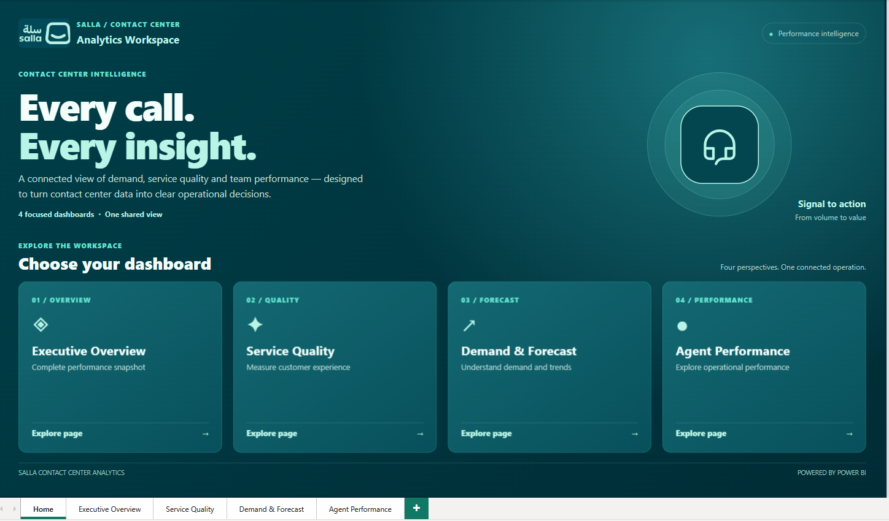
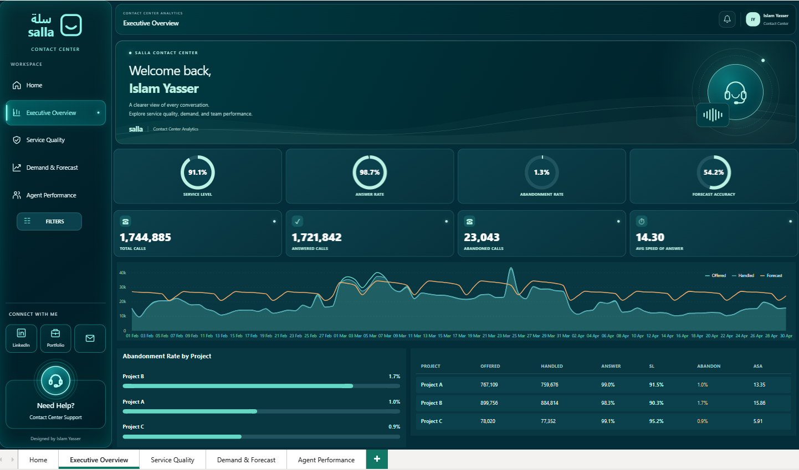
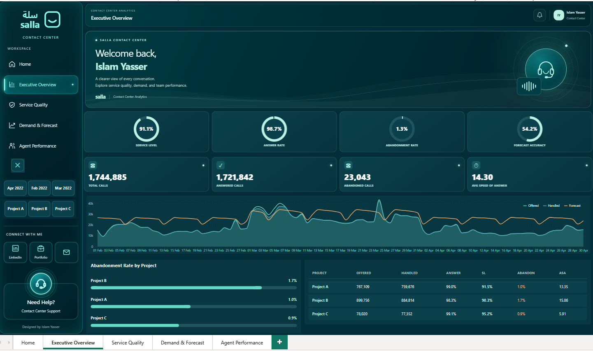
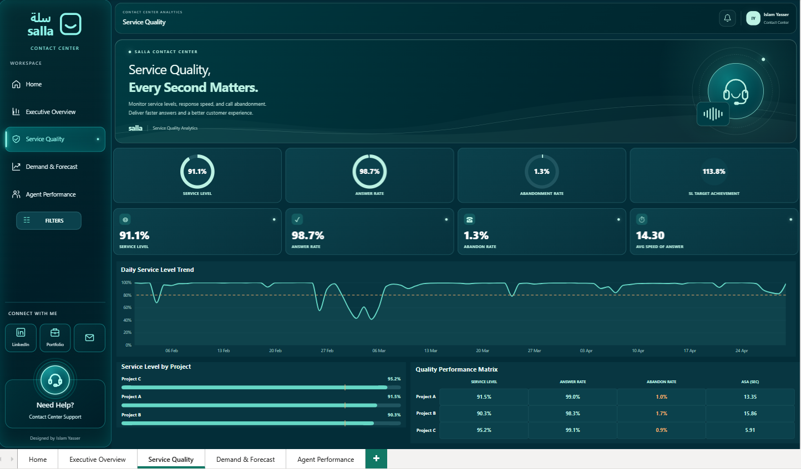
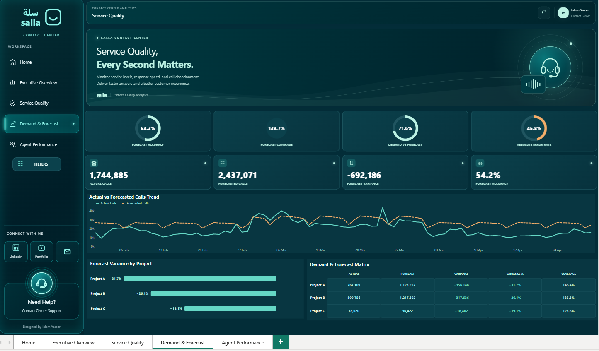
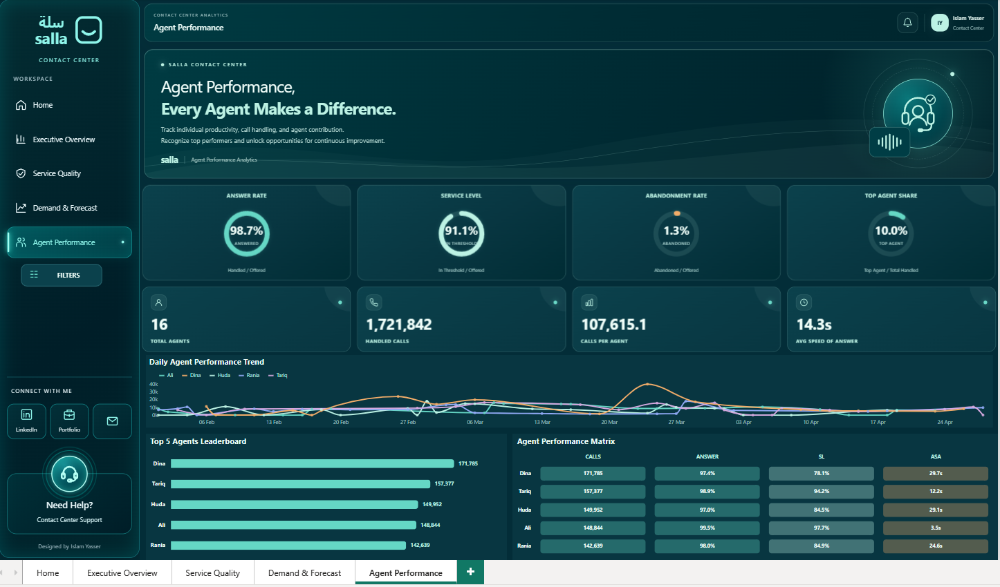

# 🎧 Salla Contact Center Analytics — Executive Operations Dashboard

[](https://powerbi.microsoft.com/)
[]()
[]()
[]()
[]()
[](https://deneb-viz.github.io/)
[]()
[](https://islamyasser424-design.github.io/portfolio-/)

> **An end-to-end enterprise contact center intelligence workspace built in Microsoft Power BI. Engineered with bespoke UI/UX architecture utilizing Dynamic HTML with DAX, CSS Grid, Flexbox, custom SVG graphics, CSS keyframe animations, 3D Flip Cards, and Deneb (Vega-Lite) precision charts to monitor 1.74M+ calls across workforce operations, service quality, demand forecasting, and agent performance.**

---

## 📌 Table of Contents
- [✨ Project Overview & Business Value](#-project-overview--business-value)
- [🖥️ Interactive Dashboard Walkthrough](#️-interactive-dashboard-walkthrough)
  - [0. Workspace Portal & Landing Hub](#0-workspace-portal--landing-hub)
  - [1. Executive Overview](#1-executive-overview)
  - [2. Interactive Filter Drawer](#2-interactive-filter-drawer)
  - [3. Service Quality & Response Speed](#3-service-quality--response-speed)
  - [4. Demand & Forecasting Gaps](#4-demand--forecasting-gaps)
  - [5. Agent Productivity & Workforce Allocation](#5-agent-productivity--workforce-allocation)
- [🛠️ Data Pipeline & Power Query Append Architecture](#️-data-pipeline--power-query-append-architecture)
- [📐 Data Modeling & DAX Calculation Engine](#-data-modeling--dax-calculation-engine)
- [🎨 Design System & Custom UI/UX Engineering](#-design-system--custom-uiux-engineering)
- [💡 Deep-Dive Strategic Findings & Insights](#-deep-dive-strategic-findings--insights)
- [🚀 Planned Roadmap: Issues & Actionable Recommendations](#-planned-roadmap-issues--actionable-recommendations)
- [🎯 Interview & Portfolio Talking Points](#-interview--portfolio-talking-points)
- [📂 Repository Structure](#-repository-structure)
- [💻 How to Open and Run](#-how-to-open-and-run)
- [👤 Author & Connect](#-author--connect)

---

## ✨ Project Overview & Business Value

Managing high-volume customer contact centers for an e-commerce ecosystem like **Salla** requires constant balance between customer satisfaction, operational capacity, and resource allocation. 

This dashboard transforms **1,744,885 raw contact center records** across multiple months into an executive decision-making environment. Rather than presenting static aggregates, the model equips operations directors, workforce managers (WFM), and team leads with drill-through capabilities to:
1. **Audit Global Call Fulfillment:** Evaluate arrival demand vs. agent answering capacity in real-time.
2. **Benchmark Service Quality Standards:** Track contractual Service Level (SL) adherence against an **80% threshold** and minimize abandonment.
3. **Reconcile Demand Forecasting Inaccuracies:** Compare predicted call volumes against actual arrival patterns to prevent understaffing or labor overspend.
4. **Isolate Individual Agent Contribution:** Balance workload distribution across 16 agents, distinguishing between volume handlers and quality leaders.

---

## 🖥️ Interactive Dashboard Walkthrough

### 0. Workspace Portal & Landing Hub
A branded landing hub providing seamless navigation into all four dedicated analytical views, designed with custom CSS cards, hover states, and Salla's brand identity.



* **Features:** 4 modular launch cards, floating headset status animation, breadcrumbs, and bottom tab synchronization.

---

### 1. Executive Overview
The high-level command center giving executives an instantaneous pulse check on overall operations.



#### 📊 Core Verified Snapshot Metrics:
* **Total Calls Offered:** `1,744,885`
* **Total Calls Handled:** `1,721,842` (Answer Rate: **`98.7%`**)
* **Abandoned Calls:** `23,043` (Abandonment Rate: **`1.3%`**)
* **Global Service Level:** **`91.1%`** (within threshold)
* **Average Speed of Answer (ASA):** **`14.30 seconds`**
* **Forecast Accuracy Indicator:** **`54.2%`**

#### 🔍 Visual Highlights:
* **Circular Gauges:** Custom HTML/SVG circular gauges presenting Service Level, Answer Rate, Abandonment Rate, and Forecast Accuracy.
* **Intraday Trend (Deneb / Vega-Lite):** Multi-series timeline tracking Offered (Mint line), Handled (Cyan shaded area), and Forecasted (Orange line) across the 3-month reporting horizon.
* **Project Abandonment Comparison:** Horizontal progress bars isolating abandonment by project:
  * **Project B:** `1.7%` *(highest friction point)*
  * **Project A:** `1.0%`
  * **Project C:** `0.9%`
* **Cross-Project Matrix:** Granular comparative tabular view showing volumes, response rates, and speed of answer for Projects A, B, and C.

---

### 2. Interactive Filter Drawer
A slide-out drawer mechanism engineered using **Power BI Bookmarks, Selection Panes, and Blank Buttons** to provide uncluttered report exploration without sacrificing canvas real estate.



* **Controls:** 
  * Temporal filtering by Month (`Feb 2022`, `Mar 2022`, `Apr 2022`).
  * Dimensional slicing by Project (`Project A`, `Project B`, `Project C`).
  * One-click drawer toggle `[X]` to preserve full-width layout visibility.

---

### 3. Service Quality & Response Speed
A focused analytical view measuring customer experience, response efficiency, and threshold adherence over time.



#### 📊 Key Metrics:
* **Service Level:** `91.1%`
* **Answer Rate:** `98.7%`
* **Abandonment Rate:** `1.3%`
* **SL Target Achievement:** **`113.8%`** (exceeding standard expectations)
* **Weighted ASA:** **`14.30s`**

#### 🔍 Visual Highlights:
* **Daily Service Level Trend with Reference Line:** Daily timeline visual plotting Service Level % against an **80.0% benchmark target reference line**, immediately highlighting operational dips (e.g. late February and early March anomalies dropping below 60%).
* **Project Service Level Benchmarking:**
  * **Project C:** `95.2%` *(Quality Leader)*
  * **Project A:** `91.5%`
  * **Project B:** `90.3%`
* **Quality Performance Matrix:** Comprehensive cross-tabulation detailing Service Level, Answer Rate, Abandon Rate, and ASA (sec) per project.

---

### 4. Demand & Forecasting Gaps
An operational diagnostic page comparing workforce forecasting models against actual arrival demand.



#### 📊 Key Metrics:
* **Actual Inbound Calls:** `1,744,885`
* **Forecasted Calls:** `2,437,071`
* **Volume Variance:** **`-692,186 calls`** (Demand was **28.4% below forecast**)
* **Demand vs. Forecast Ratio:** **`71.6%`**
* **Forecast Coverage:** **`139.7%`**
* **Absolute Error Rate:** **`45.8%`**
* **Forecast Accuracy Score:** **`54.2%`**

#### 🔍 Visual Highlights:
* **Actual vs. Forecast Trend (Deneb):** Contrasting solid Mint line (Actual Calls) with dashed Orange line (Forecasted Calls), demonstrating systematic over-forecasting across all weeks.
* **Forecast Variance by Project (Horizontal Bar Visual):**
  * **Project A:** `-31.7%` variance (`-356,148` calls below forecast)
  * **Project B:** `-26.1%` variance (`-317,636` calls below forecast)
  * **Project C:** `-19.1%` variance (`-18,402` calls below forecast)
* **Demand & Forecast Matrix:** Auditing exact Actual, Forecast, Variance, Variance %, and Coverage numbers per business line.

---

### 5. Agent Productivity & Workforce Allocation
Shifting the analytical lens from executive aggregates to individual representative performance across 16 support agents.



#### 📊 Key Metrics:
* **Total Active Agents:** `16`
* **Handled Volume:** `1,721,842 calls`
* **Average Volume per Agent:** `107,615.1 calls`
* **Average Speed of Answer:** `14.3 seconds`
* **Top Agent Share:** `10.0%` of all handled calls handled by the leading agent

#### 🔍 Visual Highlights:
* **Top 5 Agents Leaderboard (Handled Calls):**
  1. 🥇 **Dina:** `171,785 calls`
  2. 🥈 **Tariq:** `157,377 calls`
  3. 🥉 **Huda:** `149,952 calls`
  4. 🎖️ **Ali:** `148,844 calls`
  5. 🎖️ **Rania:** `142,639 calls`
* **Daily Agent Throughput Trend:** Tracking agent call volume consistency across the full 90-day timeline.
* **Agent Performance Matrix (Volume vs. Quality Correlation):**

| Agent | Handled Calls | Answer Rate | Service Level | Avg ASA | Operational Profile |
| :--- | :---: | :---: | :---: | :---: | :--- |
| **Ali** | 148,844 | **99.5%** | **97.7%** | **3.5s** | 🌟 **Top Quality & Speed Leader** (Ultra-fast response) |
| **Tariq** | 157,377 | **98.9%** | **94.2%** | **12.2s** | ⚡ **High Volume & Strong Quality** |
| **Rania** | 142,639 | 98.0% | 84.9% | 24.6s | ⚖️ Consistent Mid-Tier Contributor |
| **Huda** | 149,952 | 97.0% | 84.5% | 29.1s | ⏳ High Volume with elevated hold/wait times |
| **Dina** | **171,785** | 97.4% | 78.1% | 29.7s | 🏋️ **Workhorse Handler** (Highest volume, lowest SL) |

> 💡 **Key Insight:** **Ali** delivered world-class metrics with a **3.5s ASA** and **97.7% Service Level**, while **Dina** handled the highest gross volume (`171.8K`) but experienced lower threshold compliance (**78.1%**), highlighting the critical necessity of evaluating quality metrics alongside gross throughput.

---

## 🛠️ Data Pipeline & Power Query Append Architecture

### 🔄 The Append Queries Strategy
The original telephony data was delivered across **3 separate monthly sheets** (`Month 1`, `Month 2`, `Month 3`). 

Rather than maintaining siloed tables or attempting relational merges (which combine columns horizontally based on keys), the solution utilized an **Append Queries** workflow in **Power Query (M Language)** to stack rows vertically into a single consolidated analytical table:

```
┌────────────────────────┐      ┌────────────────────────┐      ┌────────────────────────┐
│     Month 1 Sheet      │      │     Month 2 Sheet      │      │     Month 3 Sheet      │
│  (February Call Data)  │      │   (March Call Data)    │      │   (April Call Data)    │
└───────────┬────────────┘      └───────────┬────────────┘      └───────────┬────────────┘
            │                               │                               │
            └───────────────────────┬───────┴───────────────────────────────┘
                                    │
                                    ▼  [Power Query: Append Queries]
                        ┌───────────────────────┐
                        │    Unified Dataset    │
                        │ (1.74M+ Consolidated) │
                        └───────────────────────┘
```

#### Why Append, Not Merge?
* **Append (Vertical Stacking):** Adds rows from each month underneath the preceding month. This preserves identical schema headers, creates a continuous timeline for trend analysis, and simplifies DAX calculations over the full 90-day period.
* **Merge (Horizontal Joining):** Would incorrectly attach columns sideways, creating redundant schema bloat and destroying time-series continuity.

### 📋 Unified Dataset Schema:

| Column Name | Data Type | Analytical Application |
| :--- | :---: | :--- |
| `Project` | Text | Segmenting operations across Project A, Project B, and Project C |
| `Date` | Date | Time-series modeling, calendar relationships, daily trend analysis |
| `Month` | Text | High-level monthly comparisons and seasonal aggregations |
| `Forecasted Calls` | Whole Number | Planned/forecasted arrival call volume |
| `Calls Offered` | Whole Number | Actual total inbound call attempts arriving at the queue |
| `Calls Handled` | Whole Number | Successful calls connected with an agent |
| `Calls Handled With in Thrshold` | Whole Number | Calls answered within contractual threshold (≤ 20 seconds) |
| `Calls Abandon` | Whole Number | Calls disconnected by the customer prior to agent pickup |
| `ASA` | Decimal / Time | Average Speed of Answer for the transactional interval |
| `Answer Time` | Decimal / Time | Total response duration metrics |
| `Agent Name` | Text | Representative assignment and individual scorecards |
| `Deneb Date` | Calculated (Text) | ISO `yyyy-MM-dd` formatted string for custom Vega-Lite chart bindings |

---

## 📐 Data Modeling & DAX Calculation Engine

All KPIs are formulated via explicit DAX measures to ensure full responsiveness across interactive slicers, cross-filtering, and bookmark states:

### 1. Volume & Fulfillment Measures
```dax
// Total Inbound Call Traffic
Total Offered = 
SUM ( Dataset[Calls Offered] )

// Total Handled Calls by Agents
Total Handled = 
SUM ( Dataset[Calls Handled] )

// Total Lost / Abandoned Calls
Total Abandoned = 
SUM ( Dataset[Calls Abandon] )

// Handled Fulfillment Percentage
Answer Rate = 
DIVIDE ( [Total Handled], [Total Offered], 0 )
```

### 2. Service Quality & Speed Measures
```dax
// Service Level Compliance (Calls answered within threshold / Total offered)
Service Level = 
DIVIDE ( 
    SUM ( Dataset[Calls Handled With in Thrshold] ), 
    [Total Offered], 
    0 
)

// Abandonment Percentage
Abandonment Rate = 
DIVIDE ( [Total Abandoned], [Total Offered], 0 )

// Service Level Target Achievement (Benchmarked against 80% target)
SL Target Achievement = 
DIVIDE ( [Service Level], 0.80, 0 )

// Weighted Average Speed of Answer (Prevents "Average of Averages" Distortion)
Weighted ASA = 
DIVIDE (
    SUMX ( Dataset, Dataset[ASA] * Dataset[Calls Handled] ),
    [Total Handled],
    0
)
```

### 3. Forecasting & Demand Variance Measures
```dax
// Total Predicted Demand
Total Forecast = 
SUM ( Dataset[Forecasted Calls] )

// Absolute Call Volume Variance
Forecast Variance = 
[Total Offered] - [Total Forecast]

// Relative Forecast Variance Percentage
Forecast Variance % = 
DIVIDE ( [Forecast Variance], [Total Forecast], 0 )

// Actual Demand vs. Forecast Ratio
Demand vs Forecast = 
DIVIDE ( [Total Offered], [Total Forecast], 0 )

// Forecast Coverage Ratio
Forecast Coverage = 
DIVIDE ( [Total Forecast], [Total Offered], 0 )

// Forecast Accuracy Index
Forecast Accuracy = 
1 - DIVIDE ( 
    ABS ( [Forecast Variance] ), 
    [Total Forecast], 
    0 
)
```

### 4. Agent Productivity & Workforce Allocation
```dax
// Average Calls Handled per Agent
Calls per Agent = 
DIVIDE ( 
    [Total Handled], 
    DISTINCTCOUNT ( Dataset[Agent Name] ), 
    0 
)

// Individual Agent Workload Contribution %
Agent Contribution = 
DIVIDE ( 
    [Total Handled], 
    CALCULATE ( [Total Handled], ALL ( Dataset[Agent Name] ) ), 
    0 
)
```

---

## 🎨 Design System & Custom UI/UX Engineering

The workspace abandons the generic corporate Power BI appearance in favor of a **Dark Teal Premium Design System** specifically inspired by **Salla's brand identity**:

### 🎨 Visual Color Tokens:
* `Canvas Background:` `#032D38` (Deep Midnight Teal)
* `Chart Cards & Containers:` `#083641` (Subtle Glass Layer)
* `Primary Accent (Actuals):` `#65D7C5` (Vibrant Mint)
* `Warning Accent (Forecasts):` `#F3AD69` (Warm Amber Orange)
* `Text & Metric Highlights:` `#FFFFFF` / `#B2DFDB` (Crisp Contrast)

### 🌟 Advanced UI/UX & Web Styling Architecture:
1. **Dynamic HTML with DAX (HTML Content Visual):**
   * Engineered dynamic DAX measures that construct inline HTML5 & CSS3 templates in real time based on active slicers and drill-down states.
   * Dynamic HTML banners with personalized greeting headers and real-time user tags (`Welcome back, Islam Yasser`).
2. **Modern CSS Layout Engine (CSS Grid & Flexbox):**
   * Multi-column executive KPI card containers structured with **CSS Grid** for precise grid-gap and alignment.
   * Internal card alignment of badges, operational indicators, and icon wrappers structured with **CSS Flexbox**.
3. **Interactive 3D Flip Cards & CSS Keyframe Animations:**
   * Interactive **3D Flip Cards** utilizing `perspective`, `transform: rotateY()`, and `backface-visibility` to reveal detailed SLA and variance breakdowns on hover/interaction.
   * Keyframe **CSS Animations**: continuous floating headset badge effect (`@keyframes float`), glowing pulse rings, and wave line transitions.
4. **Dynamic SVG Vector Graphics & Circular Gauges:**
   * Handcrafted vector **SVG graphics** calculated directly via DAX string manipulation.
   * Custom circular SVG gauge meters dynamically controlling `stroke-dasharray` and `stroke-dashoffset` for real-time visualization of Service Level (91.1%), Answer Rate (98.7%), Abandonment Rate (1.3%), and Forecast Accuracy (54.2%).
5. **Deneb & Vega-Lite Custom Visualizations:**
   * Custom line and area charts with dual-color themes, custom dashed strokes for forecasts, and pixel-precise axis padding.
   * Tailored horizontal bar visuals for leaderboards and project variance ranking.
6. **Seamless Bookmark Navigation:**
   * Sidebar navigation menu mimicking a native web app.
   * Drawer toggle for filters, creating a clean executive canvas while preserving deep-dive filtering power.

---

## 💡 Deep-Dive Strategic Findings & Insights

| Focus Area | Key Observation | Operational Implication & Recommendation |
| :--- | :--- | :--- |
| 📉 **Demand Over-Forecasting** | Total actual calls (`1.74M`) were **`28.4%` lower** than forecasted (`2.44M`), resulting in a **692K call gap**. | **Review WFM Forecasting Models:** Over-forecasting risks over-scheduling agents and incurring unneeded operational labor expense. Erlang-C staffing requirements must be recalibrated. |
| 🏆 **Project Quality Variance** | **Project C** achieved the highest SL (**`95.2%`**) and lowest ASA (**`5.91s`**), while **Project B** lagged with lowest SL (**`90.3%`**) and highest abandonment (**`1.7%`**). | **Rebalance Queue Prioritization:** Shift trained agents or adjust routing logic from Project C to Project B during mid-day peak arrival intervals. |
| 👥 **Workload Distribution Gap** | **Dina** handled the highest gross volume (`171.8K`), but had lower Service Level (`78.1%`) and high ASA (`29.7s`). In contrast, **Ali** maintained a **`97.7%` SL** with an ultra-fast **`3.5s` ASA**. | **Targeted Coaching & Quality Auditing:** High gross call counts do not equate to optimal service. Implement quality coaching for high-volume agents to shorten hold times and raise first-contact resolution. |
| ⏱️ **Temporal Drop Anomalies** | Service Level experienced sharp temporary dips below the 80% reference target during late February and early March. | **Intraday Peak Root-Cause Analysis:** Investigate specific seasonal promotion dates or system outages that caused sudden queue spikes during those days. |

---

## 🚀 Planned Roadmap: Issues & Actionable Recommendations

Building upon the 4 primary operational pages, an upcoming **Issues & Actionable Recommendations** view is architected to translate findings directly into managerial action items:

```
┌────────────────────────────────────────────────────────────────────────────────────────┐
│                   PLANNED RECOMMENDATION ARCHITECTURE (PAGE 5)                         │
├──────────────────────────┬─────────────────────────────┬───────────────────────────────┤
│    Identified Gap        │     Root Cause Analysis     │    Proposed Action Item       │
├──────────────────────────┼─────────────────────────────┼───────────────────────────────┤
│ 1. 28.4% Forecast Gap    │ Static historical growth    │ Integrate ML-based dynamic    │
│    (-692K calls)         │ assumption without promo sync│ forecasting linked to promos │
├──────────────────────────┼─────────────────────────────┼───────────────────────────────┤
│ 2. Project B High        │ Higher customer hold time   │ Optimize IVR self-service and │
│    Abandonment (1.7%)    │ and longer queue wait times │ redeploy Project C surplus    │
├──────────────────────────┼─────────────────────────────┼───────────────────────────────┤
│ 3. Agent Speed Disparity │ Inconsistent handling paths │ Pair Ali with Dina for peer   │
│    (3.5s vs 29.7s ASA)   │ and manual desktop research │ knowledge-sharing & playbook  │
└──────────────────────────┴─────────────────────────────┴───────────────────────────────┘
```

---

## 🎯 Interview & Portfolio Talking Points

When discussing this project with recruiters, engineering leads, or hiring managers:

1. **End-to-End Ownership:**
   > *"I managed the full business intelligence lifecycle—starting from raw, fragmented monthly Excel sheets, performing Power Query Append transformations, building clean DAX metrics, and engineering a bespoke UX in Power BI."*
2. **Preventing Statistical Distortion:**
   > *"Instead of taking a naive average of the ASA column (which causes the 'Average of Averages' distortion), I formulated a weighted-average DAX measure using SUMX weighted by handled call volume, ensuring mathematical precision."*
3. **Advanced Visual Customization:**
   > *"Rather than relying on default Power BI visuals, I integrated HTML5 and CSS3 via the HTML Content visual for responsive cards and circular gauges, and used Deneb with Vega-Lite for precision dual-line forecasting charts."*
4. **Actionable Business Impact:**
   > *"The project proved that gross call volume alone is misleading: the agent with the highest volume (Dina) had lower threshold adherence, while another agent (Ali) sustained a 97.7% Service Level with a 3.5-second answer speed."*

---

## 📂 Repository Structure

```
SALla-call-center-Dashboard/
├── assets/
│   ├── 00_Home_Workspace.png                      # Workspace landing hub
│   ├── 01_Executive_Overview.png                  # Executive Overview dashboard
│   ├── 02_Executive_Overview_Filter_Drawer.png    # Interactive filter drawer open state
│   ├── 03_Service_Quality.png                     # Service Quality & ASA analysis
│   ├── 04_Demand_and_Forecast.png                 # Actual vs Forecasted variance
│   └── 05_Agent_Performance.png                   # Agent leaderboard & scorecards
├── Salla_Contact_Center_Analytics.pbix            # Complete interactive Power BI report
└── README.md                                      # Executive documentation & technical case study
```

---

## 💻 How to Open and Run

### Prerequisites:
* **Microsoft Power BI Desktop** (Updated release recommended).
* Internet connection for external Deneb / SVG visual rendering.

### Steps:
1. **Clone the repository:**
   ```bash
   git clone https://github.com/islamyasser424-design/SALla-call-center-Dashboard.git
   cd SALla-call-center-Dashboard
   ```
2. **Open the Report:**
   * Double-click `Salla_Contact_Center_Analytics.pbix` to launch the complete report in Power BI Desktop.
3. **Interact & Explore:**
   * Navigate using the branded **Sidebar Navigation** (`Home`, `Executive Overview`, `Service Quality`, `Demand & Forecast`, `Agent Performance`).
   * Click the **FILTERS** button on any page to slide out the interactive drawer and filter by month or project.

---

## 👤 Author & Connect

* **Islam Yasser** — Data Analyst & Business Intelligence Specialist
* 🌐 **Portfolio Website:** [islamyasser424-design.github.io/portfolio-](https://islamyasser424-design.github.io/portfolio-/)
* 💼 **LinkedIn Profile:** [linkedin.com/in/islam-yasser-55048b378](https://www.linkedin.com/in/islam-yasser-55048b378/)
* 📧 **Direct Email:** [islamyasser424@gmail.com](mailto:islamyasser424@gmail.com)
* 🐙 **GitHub Repositories:** [@islamyasser424-design](https://github.com/islamyasser424-design)

---
⭐ *If you find this contact center intelligence project insightful or inspiring for your BI workflows, please consider giving it a star!*
